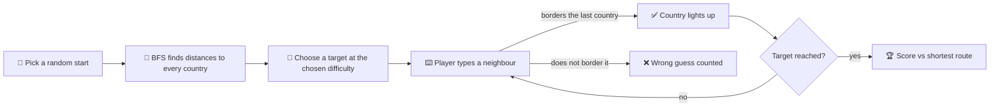

<div align="center">

# 🗺️ Travel There
 
### Connect any two countries on Earth, one neighbour at a time.
 
A browser-based geography puzzle game with a zoomable, draggable world map that loops around the globe.
 


 
[🎮 Play the game](#) · [✨ Features](#-features) · [🧠 How it works](#-how-it-works) · [🚀 Run it locally](#-run-it-locally)
 
</div>

---
 
## 🎯 The idea
 
You get a **start country** and a **target country**. Type the countries that connect them, one at a time, where each one must **share a border** with the one before it.
 
> 🇵🇹 Portugal → 🇪🇸 Spain → 🇫🇷 France → 🇩🇪 Germany → 🇵🇱 Poland
 
Finish the route, and the game tells you how close you got to the **shortest possible path**.
 
---
 
## ✨ Features
 
| | Feature | Details |
|---|---|---|
| 🌍 | **Real world map** | Every country is drawn with its real outline, not dots on a blank background |
| 💡 | **Countries light up** | A correct guess fills the country on the map: 🔵 start, 🟢 route, 🩷 target |
| 🔍 | **Zoom and drag** | Scroll wheel, pinch on touch screens, drag to pan, plus on-screen buttons |
| 🔁 | **Looping map** | Pan past the east edge of Asia and you come out in the Americas, like a globe |
| 🏝️ | **Island nations** | Countries with no land border connect to their nearest neighbours with faint dashed sea links |
| 🧊 | **Greenland bridge** | The Americas link to Eurasia through Canada → Greenland → Denmark, and Alaska ↔ Russia (the Diomede Islands) |
| 🧠 | **Shortest-route scoring** | Your route is compared with the optimal one found by a graph search |
| 🎚️ | **3 difficulty levels** | Easy (3-4 steps), Medium (5-6) and Hard (7+) |
| 💬 | **Autocomplete** | Suggestions as you type, with aliases (USA, UK, UAE, Czechia, and more) |
| ↩️ | **Undo, reveal, new puzzle** | Take back a step, show the shortest route, or start over |
| 🌗 | **Light and dark mode** | Follows your system theme automatically |
| 📱 | **Responsive** | Works on phones, tablets and desktops |
 
---
 
## 🧠 How it works
 
The world is modelled as a **graph**: countries are nodes, and land borders and sea links are edges.
 

 
### 🔬 Under the hood
 
- **Breadth-first search (BFS)** finds the shortest route. It is used for scoring, for choosing puzzles by difficulty, and for the "Show shortest route" button.
- **Adjacency list** stores which countries touch which. Borders are listed once and made two-way when the page loads.
- **SVG map** has one `<path>` per country. Lighting up a country is just a CSS class change.
- **Looping world** draws the map twice side by side and wraps the pan position. Links that cross the 180° line are split into two segments, so they leave one edge and re-enter from the other.
- **Pointer Events** handle drag and pinch zoom with the same code for mouse and touch.
---
 
## 🧰 Tech stack
 
| Layer | Tech |
|---|---|
| 🖥️ Structure | HTML5 |
| 🎨 Styling | CSS3 with custom properties (theme tokens) |
| ⚙️ Logic | Vanilla JavaScript (ES6+), with no frameworks or libraries |
| 🗺️ Map | Inline SVG |
| 🧮 Algorithm | Breadth-first search |
 
**Build-time only** (used once to generate the country outlines, not shipped):
 


 
---
 
## 🚀 Run it locally
 
No install, no build step, no server.
 

1. Clone the repo

```bash
git clone https://github.com/<your-username>/Travel-There.git
```
2. Open the game
```bash
cd border-route
open index.html        # macOS
# start index.html     # Windows
# xdg-open index.html  # Linux
```
 
Or double-click `index.html`.
 
### 🌐 Host it free with GitHub Pages
 
1. Rename the game file to `index.html`.
2. Go to **Settings → Pages**.
3. Under **Source**, choose your `main` branch and click **Save**.
4. Your game is live at `https://<your-username>.github.io/border-route/`.
---
 
## 📁 Project structure
 
```text
border-route/
├── index.html    # The whole game: markup, styles, logic, map data
└── README.md
```
 
> The country outlines are embedded in the file as SVG path data, which is why the file is around 1 MB. The page never loads map data from anywhere else.
 
---
 
## ⚖️ Rules and design decisions
 
- 🧱 **Land borders and bridges count.** Denmark–Sweden and Singapore–Malaysia are treated as land links.
- 🏝️ **Islands use sea links** to their closest neighbours, drawn as faint dashed lines.
- 🧊 **Greenland** connects to Canada over Hans Island, and to Denmark as part of the same kingdom.
- 🌊 **Alaska and Russia** connect across the Diomede Islands.
- 🏳️ **Covered:** all 193 UN members, plus Palestine, Kosovo, Taiwan and Vatican City.
- 🚫 **Not included:** dependent territories (like Puerto Rico or Hong Kong) and disputed regions beyond those listed.
---
 
## ⚠️ Known limitations
 
- Border and sea-link data was written by hand, so a few connections may be missing or debatable. Pull requests are welcome.
- The map uses a flat equirectangular projection, so countries near the poles look larger than they are.
- Tiny countries (Monaco, Tuvalu, and others) are hard to see until you zoom in, so they also get a labelled marker.
---
 

 
## 🙏 Credits
 
- 🗺️ Country outlines: [Natural Earth](https://www.naturalearthdata.com/) via [`world-atlas`](https://github.com/topojson/world-atlas)
- 🧭 Map projection: [`d3-geo`](https://github.com/d3/d3-geo)
- 📦 Geometry conversion: [`topojson-client`](https://github.com/topojson/topojson-client)
---
 
## 📄 License
 
Released under the [MIT License](LICENSE).
 
<div align="center">
Made with 🌍 and a lot of borders by <a href="https://github.com/born1l"><b>Bornil</b></a>

</div>